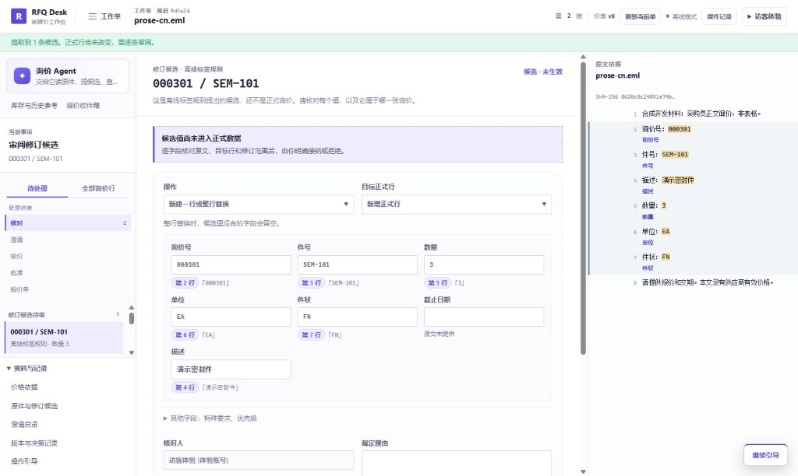
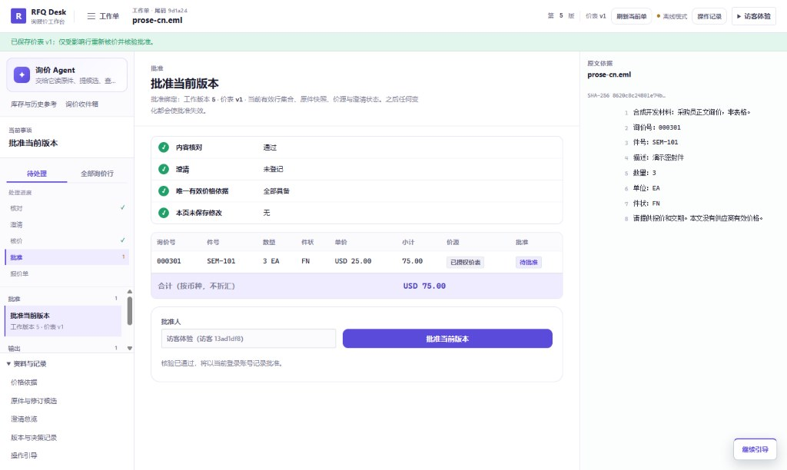
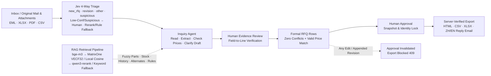

# RFQ Desk — Agent-Assisted RFQ & Quoting Workbench

[](https://github.com/1Beyond1/rfq-desk/actions/workflows/ci.yml)
[](requirements.txt)
[](LICENSE)

[简体中文](README.md)

An **agent-assisted quoting workbench** for general B2B, industrial, electronics, equipment, and spare-parts Requests for Quotation (RFQs). It transforms incoming inquiry emails (body text, spreadsheets, and text PDFs) into auditable, traceable quotes. The AI agent reads originals, extracts line-level evidence-bound candidates, queries stock/history/pricing, and drafts clarification emails — while **candidate acceptance, pricing, approval, and formal export always remain human-controlled**, with automatic approval invalidation on any subsequent change.

---

## Screenshots

| Workspace Home & Inquiry Assistant (Todos + Inbox Cards) | Candidate Review (Field-Level Evidence Citations) |
|---|---|
|  |  |

<details>
<summary>More screenshots: Approval Gate & Snapshot Lock</summary>



</details>

---

## Key Features

- **Jev Inbox Triage & Prompt-Injection Gate**:
  - Account-scoped inquiry inbox powered by **Jev (`jev-latest`)** classifying emails into four fixed options (`new_rfq`, `revision`, `other`, `suspicious`) with calibrated probability bars and confidence scores.
  - Automatically flags suspicious prompt-injection attempts, low confidence (`< 0.8`), or narrow top-2 margins (`< 0.2`) for mandatory human review/override; degrades gracefully to **`qwen3-rerank`** and then **local rule-based triage** when Jev is unavailable.
- **Multi-Stage RAG Semantic Retrieval & Exact Reference Store**:
  - Exact SQL lookups for known part numbers/SKUs (MatrixOne SQL first, SQLite local replica fallback) checking stock availability/shortages, historical quote deltas, and explicit alternates.
  - Full **RAG pipeline** for natural-language descriptions and business rules: **`bge-m3`** (1024-dim embeddings) → **MatrixOne `VECF32` `COSINE_SIMILARITY`** (or local cosine vector replica) Top-5 recall → optional **`qwen3-rerank`** reranking → offline tokenized keyword fallback. Every executed stage is surfaced in the UI; retrieved records remain human-reviewed references only.
- **Multi-Format Parsing with Line-Level Provenance**: Imports `EML`, `CSV`, `XLSX`, text `PDF`, and `TXT`, recognizing common English and Chinese B2B procurement headers (`RFQ`, `P/N`/`SKU`/`Item Code`/`Model`, `Description`/`Spec`, `Qty`, `Unit`, `Condition`, `Due Date`, `Requirements`, etc.). Every extracted field is tied to exact source spans that highlight directly in the side-by-side original pane.
- **Least-Privilege Inquiry Agent (Human-in-the-Loop)**:
  - Separates workspace home tools from per-case tools for reading originals, proposing candidates, checking inventory/historical quotes/alternates, searching rules, inspecting revision diffs, and drafting clarification emails.
  - Exposes zero write tools for accepting formal rows, altering prices, approving quotes, or sending emails — preventing prompt-injection privilege escalation by construction.
- **Deterministic Business Rules, Local Snapshots & Visual Diff**:
  - Never merges distinct RFQs sharing the same part number; blocks duplicates, unresolved conflicts, unknown abbreviations, missing prices, and expired validity dates.
  - Uses exact `Decimal` arithmetic on the backend and `BigInt` fixed-point aggregation on the frontend, grouped per currency without implicit FX conversion.
  - Approval locks the active row set, original material snapshot, review note, and zero-pending-candidate state; built-in SQLite **version snapshots & field-level Diff** compare the last approval against any revision even without MatrixOne, while edits/exclusions/revisions automatically invalidate prior approvals (`409`).
- **Multi-Format Server-Verified Exports**: Exports audited HTML quotes, CSV, formatted two-sheet **Excel (`.xlsx`)** workbooks (with `@` text locking to preserve leading zeros + provenance sheet + formula-injection neutralization), and deterministic **ZH/EN quote reply email drafts** ready to copy.
- **Full Offline Loop & Productivity Tools**:
  - Without an external LLM key, the workspace home assistant falls back honestly to local deterministic queries (todos, inbox summaries, part/description stock, historical quotes, alternates, and rules);
  - Includes a downloadable general B2B RFQ CSV template, audited batch actions (fill missing condition, update expired due dates, deduplicate exact rows), status-filtered work-order lists, archive & safe delete, inbox category/keyword search, an inline 3-tab pricing reference panel (stock shortage / historical quotes / alternates), and keyboard shortcuts (`[` `]` / `Alt+S` / `/` / `?`).
- **Optional MatrixOne Integration**: SQLite serves as the resilient primary store; connecting MatrixOne adds SQL/vector retrieval, whole-database approval snapshots, candidate data branch diffs, decision auditing, and versioned agent memory.
- **Account Isolation & Responsive Guided Tour**: Built-in user/admin/guest-demo isolation (`scrypt` password hashing, SHA-256 session tokens, `HttpOnly`/`SameSite=Strict`, Origin/CSRF checks) plus a dynamic-step interactive Spotlight Tour tuned for desktop and mobile (375–390px) viewports.

---

## Workflow



---

## Quick Start

### Prerequisites

- Python **3.12+**
- Node.js **20+** (for frontend unit tests)

### 1. Install Dependencies

**Windows (PowerShell)**

```powershell
python -m venv .venv
.\.venv\Scripts\python.exe -m pip install -r requirements.txt
```

**macOS / Linux**

```bash
python3 -m venv .venv
./.venv/bin/python -m pip install -r requirements.txt
```

### 2. Run Locally (Offline Mode)

Runs completely offline with built-in synthetic fixtures — no external API keys required:

```bash
# Windows
.\.venv\Scripts\python.exe distribution/serve.py

# macOS / Linux
./.venv/bin/python distribution/serve.py
```

Open [http://127.0.0.1:5311/](http://127.0.0.1:5311/) (API listens on `http://127.0.0.1:8311`).

**Or launch with Docker Compose**

```bash
docker compose up --build
```

### 3. Enable Auth & OpenAI-Compatible LLM (Optional)

```bash
export RFQ_AUTH_REQUIRED=1
export RFQ_COOKIE_SECURE=0           # Use 0 for local HTTP, keep 1 behind HTTPS
export RFQ_MODEL_URL="https://api.example.com/v1/chat/completions"
export RFQ_MODEL_NAME="your-model-name"
export RFQ_MODEL_KEY="your-api-key"
export RFQ_JEV_KEY="your-jev-key"    # Optional: enable Jev 4-way inbox triage
export RFQ_REFERENCE_RERANK=1        # Optional: enable qwen3-rerank in RAG search

./.venv/bin/python distribution/serve.py --model
```

Manage local accounts via `python scripts/accounts.py`. See [`.env.example`](.env.example) for the full configuration reference.

---

## Testing

```bash
# Python backend test suite
python -m pytest tests -q

# Frontend JavaScript unit tests
node --test tests/*.test.cjs
```

---

## Repository Layout

```text
rfq-desk/
├── apps/
│   ├── api/            # FastAPI backend: parsing, domain rules, agent, accounts, inbox, MatrixOne
│   └── web/            # Vanilla HTML/CSS/JS 3-pane workbench, mobile layout & Spotlight tour
├── data/synthetic/     # 100% synthetic emails, spreadsheets, price catalogs, inbox & references
├── distribution/       # Unified local runner and container check utilities
├── docs/               # Data dictionary, clarification loop, runbooks, and UI screenshots
├── evals/              # Independent EvidenceIndex and offline/protocol evaluation harness
├── scripts/            # Local Range-capable static server, account CLI & fixture generators
└── tests/              # Python pytest and Node frontend unit tests
```

---

## License

Licensed under the [MIT License](LICENSE). All sample records included in `data/synthetic/` are synthetic test fixtures.
