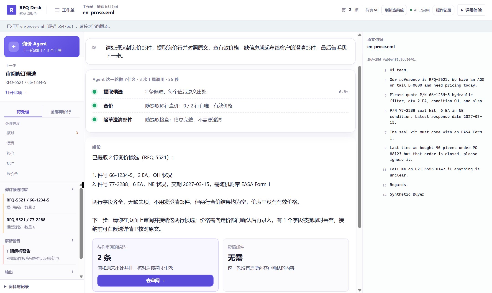
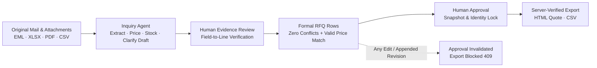

# RFQ Desk — Aviation Spare Parts RFQ & Quoting Workbench

[简体中文](README.md)

An **agent-assisted quoting workbench** for aviation spare parts Requests for Quotation (RFQs). It transforms incoming inquiry emails (body text, spreadsheets, and text PDFs) into auditable, traceable quotes. The AI agent reads originals, extracts line-level evidence-bound candidates, queries stock/history/pricing, and drafts clarification emails — while **candidate acceptance, pricing, approval, and formal export always remain human-controlled**, with automatic approval invalidation on any subsequent change.

---

## Screenshots

| Inquiry Agent Workbench (Live Tool Timeline + Original Mail) | Candidate Review (Field-Level Evidence Citations) |
|---|---|
|  |  |

<details>
<summary>More screenshots: Approval Gate & Snapshot Lock</summary>


</details>

---

## Key Features

- **Multi-Format Parsing with Line-Level Provenance**: Imports `EML`, `CSV`, `XLSX`, text `PDF`, and `TXT` (English and Chinese headers). Every extracted field (`rfq`, `part`, `quantity`, `unit`, `condition`, `due`, etc.) is tied to exact source spans that highlight directly in the side-by-side original pane.
- **Least-Privilege Inquiry Agent (Human-in-the-Loop)**:
  - Separates workspace home tools from per-case tools for reading originals, proposing candidates, checking inventory/historical quotes/alternates, searching rules, inspecting revision diffs, and drafting clarification emails.
  - Exposes zero write tools for accepting formal rows, altering prices, approving quotes, or sending emails — preventing prompt-injection privilege escalation by construction.
- **Deterministic Business Rules & Snapshot Integrity**:
  - Never merges distinct RFQs sharing the same part number; blocks duplicates, unresolved conflicts, unknown abbreviations, missing prices, and expired validity dates.
  - Uses exact `Decimal` arithmetic on the backend and `BigInt` fixed-point aggregation on the frontend, grouped per currency without implicit FX conversion.
  - Approval locks the active row set, original material snapshot, review note, and zero-pending-candidate state; excluding rows, editing quantities, appending revisions, or changing price catalogs automatically invalidates prior approvals and rejects stale exports (`409`).
- **Inbox Triage & Reference Search**: Includes a synthetic inbox triage workflow alongside exact SQL part lookups and vector-assisted description/rule retrieval.
- **Optional MatrixOne Integration**: SQLite serves as the resilient primary store; connecting MatrixOne adds SQL/vector retrieval, whole-database approval snapshots, candidate data branch diffs, decision auditing, and versioned agent memory.
- **Account Isolation & Responsive Guided Tour**: Built-in user/admin/guest-demo isolation (`scrypt` password hashing, SHA-256 session tokens, `HttpOnly`/`SameSite=Strict`, Origin/CSRF checks) plus an interactive Spotlight Tour tuned for both desktop and mobile (375–390px) viewports.

---

## Workflow



---

## Quick Start

### Prerequisites

- Python **3.12+**
- Node.js **20+** (for frontend unit tests)

### 1. Install Dependencies

**Windows (PowerShell)**

```powershell
python -m venv .venv
.\.venv\Scripts\python.exe -m pip install -r requirements.txt
```

**macOS / Linux**

```bash
python3 -m venv .venv
./.venv/bin/python -m pip install -r requirements.txt
```

### 2. Run Locally (Offline Mode)

Runs completely offline with built-in synthetic fixtures — no external API keys required:

```bash
# Windows
.\.venv\Scripts\python.exe distribution/serve.py

# macOS / Linux
./.venv/bin/python distribution/serve.py
```

Open [http://127.0.0.1:5311/](http://127.0.0.1:5311/) (API listens on `http://127.0.0.1:8311`).

### 3. Enable Auth & OpenAI-Compatible LLM (Optional)

```bash
export RFQ_AUTH_REQUIRED=1
export RFQ_COOKIE_SECURE=0           # Use 0 for local HTTP, keep 1 behind HTTPS
export RFQ_MODEL_URL="https://api.example.com/v1/chat/completions"
export RFQ_MODEL_NAME="your-model-name"
export RFQ_MODEL_KEY="your-api-key"

./.venv/bin/python distribution/serve.py --model
```

Manage local accounts via `python scripts/accounts.py`. See [`.env.example`](.env.example) for the full configuration reference.

---

## Testing

```bash
# Python backend test suite
python -m pytest tests -q

# Frontend JavaScript unit tests
node --test tests/*.test.cjs
```

---

## Repository Layout

```text
rfq-desk/
├── apps/
│   ├── api/            # FastAPI backend: parsing, domain rules, agent, accounts, inbox, MatrixOne
│   └── web/            # Vanilla HTML/CSS/JS 3-pane workbench, mobile layout & Spotlight tour
├── data/synthetic/     # 100% synthetic emails, spreadsheets, price catalogs, inbox & references
├── distribution/       # Unified local runner and container check utilities
├── docs/               # Data dictionary, clarification loop, runbooks, and UI screenshots
├── evals/              # Independent EvidenceIndex and offline/protocol evaluation harness
├── scripts/            # Local Range-capable static server, account CLI & fixture generators
└── tests/              # Python pytest and Node frontend unit tests
```

---

## License

Licensed under the [MIT License](LICENSE). All sample records included in `data/synthetic/` are synthetic test fixtures.
