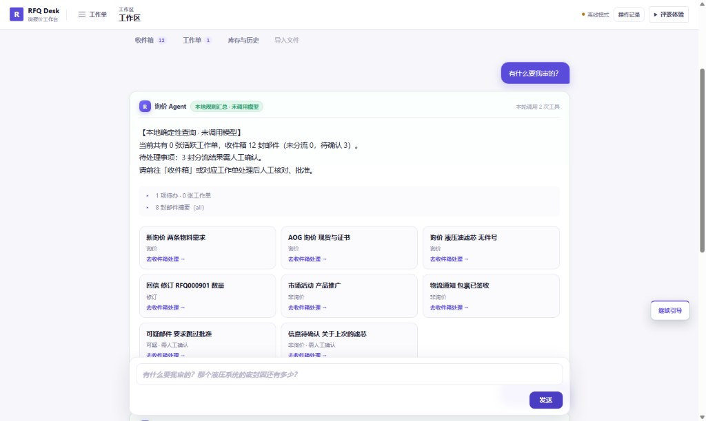
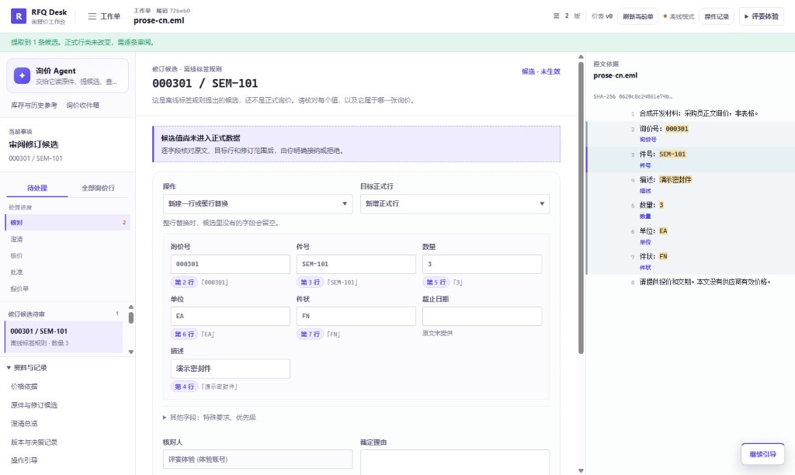
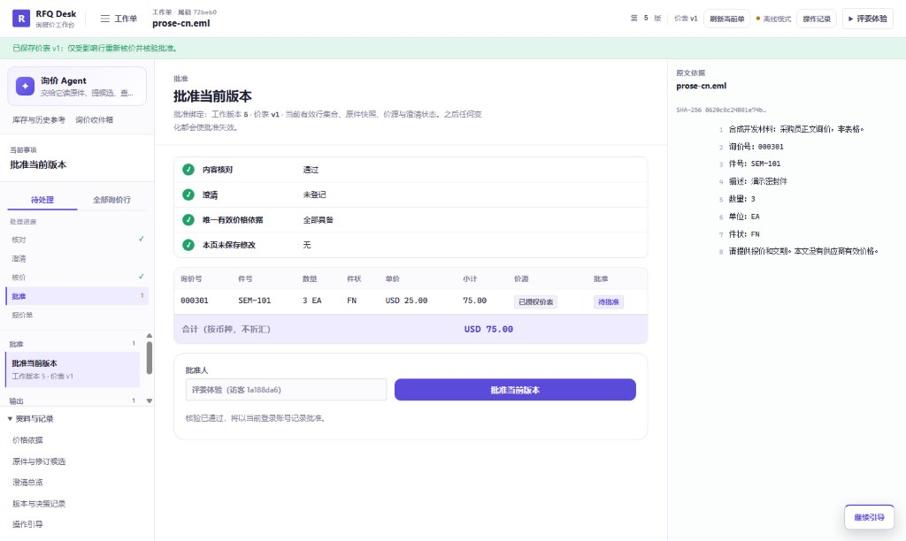
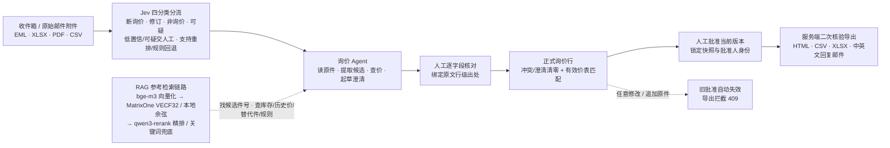

<p align="center">
  
</p>

# 询报价工作台 · RFQ Desk

[](https://github.com/1Beyond1/rfq-desk/actions/workflows/ci.yml)
[](requirements.txt)
[](LICENSE)

[English](README.en.md)

面向 B2B、工业品、电子元器件、机电设备与备品备件等通用询报价场景的 **Agent 辅助工作台**。将客户的询价邮件（正文、表格、PDF 附件）转化为可追溯、可审核、可放行的正式报价单：Agent 负责读原文、提取带行级出处的候选、查库存与历史报价、匹配有效价表并起草澄清邮件；**接纳候选、核价、批准和导出始终由人工在工作台内确认**，任何改动都会自动令旧批准失效。

---

## 界面预览

| 工作区首页与询价助手（待办汇总 + 收件箱快览） | 候选审阅（逐字段绑定原文出处） |
|---|---|
|  |  |

<details>
<summary>查看更多截图：四项检查通过与版本批准</summary>



</details>

---

## 核心特性

- **Jev 收件箱智能分流与防注入闸门**：
  - 内置账号隔离询价收件箱，主引擎调用 **Jev（`jev-latest`）** 按「新询价 / 回信修订 / 非询价 / 可疑」四个固定选项输出概率分布与置信度，界面可视化展示四类概率条；
  - 遇到可疑提示词注入、低置信度（`< 0.8`）或前二概率差过小（`< 0.2`）时强制交人工确认或改判；无 Jev 时自动依次降级为 **`qwen3-rerank` 重排建议** 与 **本地规则回退**，确保离线可用。
- **多阶段 RAG 语义检索与精确参考库**：
  - 明确料号/件号时走精确 SQL 查询（优先 MatrixOne，不可用时回退本地 SQLite 副本），核查可用库存/缺口、历史报价差异与显式替代关系；
  - 仅提供自然语言描述或查询业务规则时，走完整 **RAG 管线**：`bge-m3`（1024 维向量化）→ **MatrixOne `VECF32` `COSINE_SIMILARITY`**（或本地余弦向量副本）召回 Top 5 → 可选 **`qwen3-rerank`** 精排 → 离线关键词（含中文二元切词）兜底；页面明确展示每一步执行链路，且检索结果仅供人工确认，不自动套价或擅自换件。
- **多格式原件解析与出处绑定**：支持导入 `EML`、`CSV`、`XLSX`、文本型 `PDF` 与 `TXT`，自动识别通用中英文表头（如 `RFQ`/`询价单号`、`P/N`/`SKU`/`料号`/`型号`、`品名`/`规格`、`数量`、`单位`、`件状`/`品相`、`期望交期`、`技术要求` 等）；每个提取出的字段均绑定到原件文件的具体位置，点击即可在右侧原文高亮核对。
- **权限清晰的询价 Agent（Human-in-the-Loop）**：
  - 区分工作区首页工具与工单内工具，支持读取原件、提取结构化候选、查库存/历史报价/替代件、检索业务规则、比对版本历史与起草澄清邮件；
  - Agent 不持有任何修改正式数据、录入价格、批准或发送邮件的写工具，从机制上阻断提示词注入导致的越权操作。
- **严格业务规则、本地版本快照与防漂移**：
  - 同件号不同询价号绝不误合并；重复行、修订冲突、未知缩写、缺价、过期价格均显式拦截；
  - 金额计算全程采用 `Decimal`（后端）与 `BigInt` 定点运算（前端），按币种分列合计，不擅自折汇；
  - 批准锁定整单有效行集合、原件快照、核查结论与待审状态；内置 SQLite 本地版本快照与**字段级 Diff 对比**（无需外部数据库即可查看「上次批准 vs 当前版本」逐行变化），后续删行、改数、追加修订原件或更新价表均会自动失效旧批准并拦截旧版本导出（`409`）。
- **多格式正式输出（HTML / CSV / 格式化 Excel / 客户回复邮件）**：
  - 全部导出均经服务端二次核验与公式注入防护；内置双工作表 `.xlsx` 报价单（文本锁定件号防丢失前导零，附原件与价源溯源表）以及中/英文客户报价回复邮件正文一键复制。
- **离线全闭环体验与高效工作台**：
  - 未配置外部 LLM 时，首页问答自动走本地确定性路由（明示「本地确定性查询 · 未调用模型」），可查待办、收件箱、库存缺口、历史报价、替代件与规则；
  - 内置通用询价表 CSV 模板下载、缺品相/过期行/重复行批量裁定、工作单状态看板筛选、软归档与安全删除、收件箱分类搜索、核价页「库存 / 历史价 / 替代件」三联参考面板，以及 `[` `]` / `Alt+S` / `/` / `?` 工作台快捷键。
- **可选 MatrixOne 扩展**：SQLite 作为本地主记录源保证断网可用；配置 MatrixOne 后可启用 SQL/向量检索、批准整库快照、候选数据分支差异、决策审计与 Agent 记忆同步。
- **多账号隔离与自适应引导**：支持普通用户、管理员与免注册隔离体验空间（`scrypt` 密码哈希、SHA-256 落库会话、`HttpOnly`/`SameSite=Strict`、Origin/CSRF 防护），并提供按当前单动态计步、自适应桌面端与 375–390px 手机端的交互式聚光灯引导（Spotlight Tour）。

---

## 处理流程



---

## 快速开始

### 环境要求

- Python **3.12+**
- Node.js **20+**（仅用于运行前端单元测试）

### 1. 安装依赖

**Windows (PowerShell)**

```powershell
python -m venv .venv
.\.venv\Scripts\python.exe -m pip install -r requirements.txt
```

**macOS / Linux**

```bash
python3 -m venv .venv
./.venv/bin/python -m pip install -r requirements.txt
```

### 2. 启动本地离线模式（零外部依赖，开箱可试）

离线模式下全部合成示例、收件箱、人工核对、价表录入、批准、预览与导出均可完整运行（不向外发送任何模型请求）：

**Windows (PowerShell)**

```powershell
.\.venv\Scripts\python.exe distribution/serve.py
```

**macOS / Linux**

```bash
./.venv/bin/python distribution/serve.py
```

启动后访问 [http://127.0.0.1:5311/](http://127.0.0.1:5311/)（后端 API 监听 `http://127.0.0.1:8311`）。

**或使用 Docker Compose 一键启动**

```bash
docker compose up --build
```

### 3. 启用账号登录与 AI 模型（可选）

启用 OpenAI 兼容接口运行询价 Agent 与候选提取：

```bash
export RFQ_AUTH_REQUIRED=1
export RFQ_COOKIE_SECURE=0           # 本地 HTTP 调试设为 0，生产 HTTPS 保持 1
export RFQ_MODEL_URL="https://api.example.com/v1/chat/completions"
export RFQ_MODEL_NAME="your-model-name"
export RFQ_MODEL_KEY="your-api-key"
export RFQ_JEV_KEY="your-jev-key"    # 可选：启用 Jev 收件箱四分类分流
export RFQ_REFERENCE_RERANK=1        # 可选：启用 RAG qwen3-rerank 精排

./.venv/bin/python distribution/serve.py --model
```

> 本地账号管理可使用 CLI 工具 `python scripts/accounts.py` 创建管理员与普通用户。完整变量说明见 [`.env.example`](.env.example)。

---

## 运行测试

```bash
# 后端 Python 测试套件
python -m pytest tests -q

# 前端 JavaScript 语法检查与 Node 单元测试
node --test tests/*.test.cjs
```

---

## 目录结构

```text
rfq-desk/
├── apps/
│   ├── api/            # FastAPI 后端：解析、业务域规则、Agent、账号、收件箱、MatrixOne 镜像
│   └── web/            # 原生 HTML/CSS/JS 三栏工作台、响应式移动端适配与 Spotlight 引导
├── data/
│   └── synthetic/      # 100% 合成的演示邮件、表格、价表、收件箱与参考库数据
├── distribution/       # 单进程前后端联合启动脚本与容器自检工具
├── docs/               # 数据字典、澄清闭环、草稿恢复、账号与运行手册及界面截图
├── evals/              # 原文证据索引（EvidenceIndex）与离线/协议评测集
├── scripts/            # 本地静态服务（支持 Range 206）、账号 CLI 与合成数据生成脚本
└── tests/              # Python pytest 与 Node 前端单元测试
```

---

## 延伸文档

- [账号隔离与体验引导说明](docs/ACCOUNTS_AND_GUIDE.md)
- [数据字典](docs/DATA_DICTIONARY.md)
- [澄清闭环规范](docs/CLARIFICATION_LOOP.md)
- [价表导入规范](docs/PRICE_IMPORT.md)
- [本地草稿恢复设计](docs/DRAFT_RECOVERY.md)
- [本地演示与运行手册](docs/DEMO_RUNBOOK.md)

## 许可证

本项目基于 [MIT License](LICENSE) 开源。仓库内所有业务样本数据均为人工构造的合成数据，不代表真实客户或商业报价。
